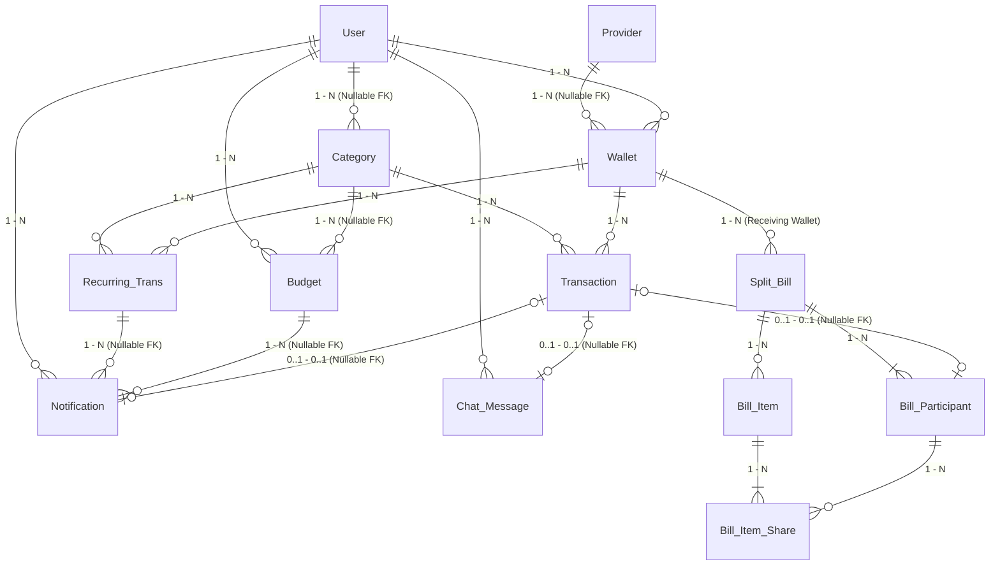

Dưới đây là tài liệu thiết kế **Conceptual ERD (Mô hình Quan niệm Thực thể - Mối quan hệ)** cho ứng dụng **Cozy Ledger**. Tài liệu này tập trung làm rõ **vai trò của từng bảng**, **bản chất các mối quan hệ** và **lý do nghiệp vụ đằng sau các khóa ngoại `Nullable` (FK Nullable)** trước khi chúng ta đi vào định nghĩa từng cột dữ liệu chi tiết.

---

# TÀI LIỆU THIẾT KẾ CONCEPTUAL ERD - COZY LEDGER

## 1. Danh sách các Thực thể (13 Bảng theo 4 Phân hệ)

Hệ thống được chia làm 4 phân hệ nghiệp vụ rõ ràng (đã lược bỏ tính năng Danh hiệu theo yêu cầu):

### Phân hệ 1: Quản lý Người dùng & Dữ liệu Danh mục (Master Data)

1. **`User`**: Lưu thông tin định danh tài khoản (Họ tên, Email, SĐT, Mật khẩu/Google OAuth) và các cài đặt cá nhân hóa (Khóa sinh trắc học FaceID/Vân tay, giờ nhắc nhở ghi chép hàng ngày, đơn vị tiền tệ, ngôn ngữ).

2. **`Provider`**: Bảng danh mục hệ thống lưu các đơn vị phát hành gồm Ngân hàng (*Sacombank, Vietcombank...*) và Ví điện tử (*MoMo...*) kèm Logo, tên đầy đủ và mã BIN ngân hàng (phục vụ tạo mã VietQR động).

3. **`Category`**: Bảng danh mục các khoản Thu (*Tiền lương, Thưởng KPI, Thu nợ bill...*) và Chi (*Ẩm thực, Mua sắm, Hóa đơn...*), có phân nhóm danh mục (`group_name` như *Chi phí sinh hoạt, Chi phí cố định*).

### Phân hệ 2: Sổ Thu Chi Cốt lõi & Kế hoạch Tài chính (Core Ledger)

4. **`Wallet`**: Quản lý toàn bộ các nguồn tiền của người dùng gồm 4 loại: *Ngân hàng, Ví điện tử, Tiền mặt* (quản lý số dư khả dụng, ví mặc định) và *Heo đất* (quản lý thêm mục tiêu tích lũy và ngày dự kiến hoàn thành).

5. **`Transaction`**: Bảng trung tâm ghi nhận mọi biến động Thu (`INCOME`) và Chi (`EXPENSE`) thực tế phát sinh trên từng Ví, phục vụ tìm kiếm, bộ lọc lịch sử và thống kê biểu đồ trên Dashboard.

6. **`Budget`**: Thiết lập hạn mức ngân sách chi tiêu theo từng tháng (cho từng danh mục cụ thể hoặc tổng ngân sách của cả tháng).

7. **`Recurring_Trans`**: Lưu cấu hình các mẫu giao dịch lặp lại theo chu kỳ (tiền điện, nước, wifi, tiền nhà...) để hệ thống tự động theo dõi và nhắc nhở khi tới hạn.

### Phân hệ 3: Trợ lý AI (Miu Miu) & Thông báo Thông minh

8. **`Notification`**: Lưu trữ các thông báo gửi tới người dùng (nhắc xác nhận giao dịch định kỳ khi tới ngày hẹn, hoặc cảnh báo khi chi tiêu sắp vượt hạn mức `Budget`).
9. **`Chat_Message`**: Lưu lịch sử hội thoại giữa người dùng và trợ lý AI Miu Miu cho cả 2 chế độ: **Trò chuyện tư vấn (RAG)** và **Thêm giao dịch bằng ngôn ngữ tự nhiên** (sử dụng cột `metadata JSONB` để lưu dữ liệu bóc tách tạm thời của Thẻ nháp giao dịch).

### Phân hệ 4: Chia Bill Nhóm & VietQR (Bill Splitting)

10. **`Split_Bill`**: Lưu thông tin chung của một hóa đơn chia tiền nhóm (tên buổi hẹn, tổng tiền, thời gian, địa điểm, phương thức chia: *Chia đều / Theo món / Tùy chỉnh*, thông tin tài khoản nhận VietQR và mã token chia sẻ link web).

11. **`Bill_Participant`**: Lưu danh sách các thành viên tham gia vào bill (tên hiển thị, vai trò Chủ xị/Host, số tiền phải đóng, ghi chú riêng và trạng thái thanh toán: *Chưa trả / Đã chuyển khoản / Tiền mặt*).

12. **`Bill_Item`**: Lưu danh sách các món ăn/đồ uống kèm số lượng và đơn giá trong một bill (dùng riêng khi người dùng chọn chế độ chia **"Theo món"**).

13. **`Bill_Item_Share`**: Bảng trung gian giải quyết mối quan hệ nhiều - nhiều (`N - N`) giữa `Bill_Item` và `Bill_Participant` (xác định những thành viên nào cùng chia một món ăn cụ thể).

---

## 2. Sơ đồ Mối quan hệ Tổng thể (Conceptual Diagram)

---

## 3. Giải thích Chi tiết Các Mối Quan Hệ & Lý do Thiết kế `FK Nullable`

Để đảm bảo tính toàn vẹn dữ liệu và đáp ứng chính xác từng màn hình UI, dưới đây là giải thích chi tiết cho từng đường nối trong sơ đồ:

### A. Nhóm Ví, Danh mục & Sổ thu chi (`User`, `Provider`, `Wallet`, `Category`, `Transaction`)

1. **`User (1) ─── (N) Wallet`** (`wallet.user_id` - **NOT NULL**):
* Mỗi người dùng sở hữu nhiều ví khác nhau (Ngân hàng, Ví điện tử, Tiền mặt, Heo đất). Mọi ví bắt buộc phải thuộc về một người dùng cụ thể.

2. **`Provider (1) ─── (N) Wallet`** (`wallet.provider_id` - **NULLABLE**):
* **Lý do FK Nullable:** Khi tạo ví loại **Ngân hàng** (Sacombank, Vietcombank...) hoặc **Ví điện tử** (MoMo...), người dùng chọn đơn vị phát hành từ danh sách `Provider` để lấy logo và thông tin ngân hàng, lúc này `provider_id != NULL`. Tuy nhiên, khi người dùng tạo ví **Tiền mặt** hoặc **Heo đất**, hai loại ví này không thuộc bất kỳ tổ chức tài chính nào nên `provider_id` sẽ mang giá trị `NULL`.

3. **`User (1) ─── (N) Category`** (`category.user_id` - **NULLABLE**):
* **Lý do FK Nullable:** Ứng dụng cung cấp sẵn bộ danh mục gốc (System Default Categories như *Ẩm thực, Mua sắm, Đi lại, Tiền lương...*) dùng chung cho toàn bộ người dùng trên hệ thống -> các bản ghi này có `user_id = NULL`. Đồng thời, trên màn hình Chọn danh mục có nút **"+ Thêm mới"** cho phép người dùng tự tạo danh mục cá nhân hóa -> các danh mục tự tạo này sẽ có `user_id = ID của người dùng đó` (chỉ người đó nhìn thấy và sử dụng).

4. **`Wallet (1) ─── (N) Transaction`** & **`Category (1) ─── (N) Transaction`** (`wallet_id`, `category_id` - **NOT NULL**):
* Mọi khoản thu/chi khi lưu vào sổ bắt buộc phải chỉ định rõ được trừ/cộng vào Ví nào (`wallet_id`) và thuộc Danh mục nào (`category_id`) để tính toán số dư ví và vẽ biểu đồ phân bổ.

---

### B. Nhóm Kế hoạch Tài chính (`Budget`, `Recurring_Trans`)

5. **`User (1) ─── (N) Budget`** (`budget.user_id` - **NOT NULL**) & **`Category (1) ─── (N) Budget`** (`budget.category_id` - **NULLABLE**):
* **Lý do `category_id` Nullable:** Trên giao diện Ngân sách và Dashboard, người dùng vừa có thể đặt hạn mức cho từng danh mục cụ thể (*Hóa đơn: 60.000đ, Ăn uống: 2.400.000đ, Học tập: 150.000đ*), vừa có một thẻ **"Tổng ngân sách: Hạn mức 3.000.000đ"** cho toàn bộ tháng đó.

* Khi `category_id != NULL`: Bản ghi biểu diễn hạn mức chi tiêu của riêng danh mục đó trong tháng.
* Khi `category_id = NULL`: Bản ghi biểu diễn **Tổng ngân sách** của người dùng (`user_id`) trong tháng đó. Cách thiết kế này giúp gom cả Tổng ngân sách và Ngân sách danh mục vào chung 1 bảng duy nhất mà không cần tách bảng thừa.

6. **`Wallet (1) ─── (N) Recurring_Trans`**, **`Category (1) ─── (N) Recurring_Trans`** (Tất cả FK đều **NOT NULL**):
* Một cấu hình giao dịch định kỳ (ví dụ: đóng tiền điện ngày 15 hàng tháng) đóng vai trò là "khuôn mẫu" (template). Nó bắt buộc phải biết giao dịch này của ai (`user_id`), thuộc danh mục nào (`category_id` - VD: *Hóa đơn*), và khi người dùng bấm xác nhận thì sẽ tự động trừ tiền từ ví nào (`wallet_id`).

---

### C. Nhóm Thông báo & Trợ lý AI (`Notification`, `Chat_Message`)

7. **`User (1) ─── (N) Notification`** (`notification.user_id` - **NOT NULL**):
* Mỗi thông báo được gửi tới hộp thư thông báo (biểu tượng quả chuông) của một người dùng cụ thể.

8. **`Recurring_Trans (1) ─── (N) Notification`** (`notification.recurring_trans_id` - **NULLABLE**) & **`Budget (1) ─── (N) Notification`** (`notification.budget_id` - **NULLABLE**):
* **Lý do FK Nullable:** Bảng `Notification` dùng chung cho nhiều loại thông báo khác nhau trong ứng dụng:
* Nếu là **thông báo nhắc giao dịch định kỳ đến hạn**: `recurring_trans_id` sẽ có giá trị (để lấy thông tin số tiền, ví, danh mục từ mẫu định kỳ), còn `budget_id = NULL`.
* Nếu là **thông báo cảnh báo sắp vượt ngân sách** (như bạn đã xác nhận): `budget_id` sẽ có giá trị (trỏ tới ngân sách đang bị vượt), còn `recurring_trans_id = NULL`.
* Nếu là thông báo hệ thống chung (VD: chào mừng, nhắc nhở ghi chép 21:00 tối): cả 2 khóa ngoại này đều `NULL`.

9. **`Transaction (0..1) ─── (0..1) Notification`** (`notification.created_transaction_id` - **NULLABLE**):
* **Lý do FK Nullable:** Khi tới ngày hẹn chu kỳ (VD: tiền wifi), hệ thống tạo một `Notification` nhắc người dùng kèm nút "Xác nhận". Lúc mới gửi thông báo, giao dịch thực tế **chưa được tạo** nên `created_transaction_id = NULL`. Ngay khi người dùng bấm **"Xác nhận"**, hệ thống tự động sinh ra 1 bản ghi trong bảng `Transaction`, trừ tiền trong `Wallet`, và lưu ID của `Transaction` vừa tạo vào `created_transaction_id`. Nhờ đó, hệ thống biết thông báo kỳ này đã được xử lý xong và khóa nút xác nhận lại.

10. **`User (1) ─── (N) Chat_Message`** (`chat_message.user_id` - **NOT NULL**) & **`Transaction (0..1) ─── (0..1) Chat_Message`** (`chat_message.confirmed_transaction_id` - **NULLABLE**):
* Mọi tin nhắn của người dùng và trợ lý Miu Miu đều lưu nội dung văn bản ở trường `content` trong `Chat_Message`.

* **Lý do `confirmed_transaction_id` Nullable:**
* Ở chế độ **Trò chuyện (RAG)**, người dùng chỉ hỏi đáp thông tin tài chính -> `metadata = NULL` và `confirmed_transaction_id = NULL`.

* Ở chế độ **Thêm giao dịch bằng ngôn ngữ tự nhiên**, khi Miu Miu vừa bóc tách câu nói thành Thẻ nháp giao dịch (*Bún bò Huế - 55.000đ*), dữ liệu nháp được lưu trong cột `metadata (JSONB)`. Lúc này người dùng đang xem trước và **chưa bấm** nút *"Xác nhận lưu vào sổ"* nên `confirmed_transaction_id = NULL`.

* Khi người dùng bấm **"Xác nhận lưu vào sổ"**, hệ thống lấy dữ liệu từ `metadata` tạo thành 1 bản ghi thật trong bảng `Transaction`, trừ số dư ví, rồi gắn ID giao dịch đó vào `confirmed_transaction_id` để giao diện hiển thị trạng thái *"Đã lưu thành công"*.

---

### D. Nhóm Chia Bill Nhóm & VietQR (`Split_Bill`, `Bill_Participant`, `Bill_Item`, `Bill_Item_Share`)

11. **`Wallet (1) ─── (N) Split_Bill`** (`split_bill.receiving_wallet_id` - **NOT NULL**):
* Người dùng tạo hóa đơn chia tiền (`creator_id`) và chọn một Ví của mình làm **Ví nhận tiền** (`receiving_wallet_id` - ví dụ ví Vietcombank). Khi bạn bè trả tiền bill, số tiền thu được sẽ tự động cộng vào ví này.

12. **`Split_Bill (1) ─── (N) Bill_Participant`** (`bill_participant.bill_id` - **NOT NULL**):
* Một hóa đơn chia tiền có nhiều thành viên tham gia (ví dụ 5 người: Mai, Tiến, Hưng, Nam, Chính). Vì bạn bè chỉ cần vào link web lấy mã VietQR để chuyển khoản mà không cần tải app hay tạo tài khoản, bảng `Bill_Participant` chỉ lưu tên hiển thị của họ mà không cần nối khóa ngoại tới bảng `User`.

13. **`Transaction (0..1) ─── (0..1) Bill_Participant`** (`bill_participant.transaction_id` - **NULLABLE**):
* **Lý do FK Nullable:**
* Lúc mới chốt bill, các thành viên đang ở trạng thái *"Chưa thanh toán"*, chưa có khoản tiền thu nợ nào được ghi vào sổ cái nên `transaction_id = NULL`.

* Khi một thành viên (VD: *Nam*) chuyển khoản VietQR hoặc trả tiền mặt và Chủ xị bấm xác nhận đã thu, hệ thống sẽ tự động tạo một bản ghi `Transaction` loại Thu nhập (*"Lẩu Haidilao cuối tuần (Nam) | +370.000đ"*) cộng thẳng vào `receiving_wallet_id`, đồng thời cập nhật ID của giao dịch đó vào `bill_participant.transaction_id`.

* Nếu Chủ xị bấm nhầm và đổi trạng thái của Nam ngược lại thành *"Chưa thanh toán"*, hệ thống chỉ cần tìm đúng `transaction_id` này để xóa giao dịch thu nhập đó và hoàn trả lại số dư ví chính xác tuyệt đối.

14. **`Split_Bill (1) ─── (N) Bill_Item`** & **`Bill_Item (N) ─── (N) Bill_Participant` (qua bảng `Bill_Item_Share`)**:
* Khi người dùng chọn tab chia tiền **"Theo món"**, một bill sẽ có danh sách các món ăn (`Bill_Item` như *Nước ngọt, Bia Tiger, Lẩu bò Triều Châu*).

* Vì một món ăn có thể do nhiều thành viên cùng ăn (VD: món *Lẩu bò* cả 5 người cùng ăn, món *Bia* chỉ có Chính và Hưng uống), và một thành viên cũng ăn nhiều món khác nhau, nên bảng trung gian `Bill_Item_Share` (`item_id`, `participant_id`) sẽ lưu chính xác ai chia món nào để tính ra tổng tiền `amount_owed` của từng người.

---

Bạn đọc lại một lượt toàn bộ bức tranh kiến trúc trên xem có luồng nào muốn điều chỉnh thêm không nhé. Nếu bạn thấy cấu trúc 13 bảng và các mối quan hệ này đã chuẩn chỉnh 100%, hãy nhắn mình để chúng ta bước sang giai đoạn **thiết kế chi tiết các trường dữ liệu (Logical/Physical ERD + mã DBML)** cho từng bảng!