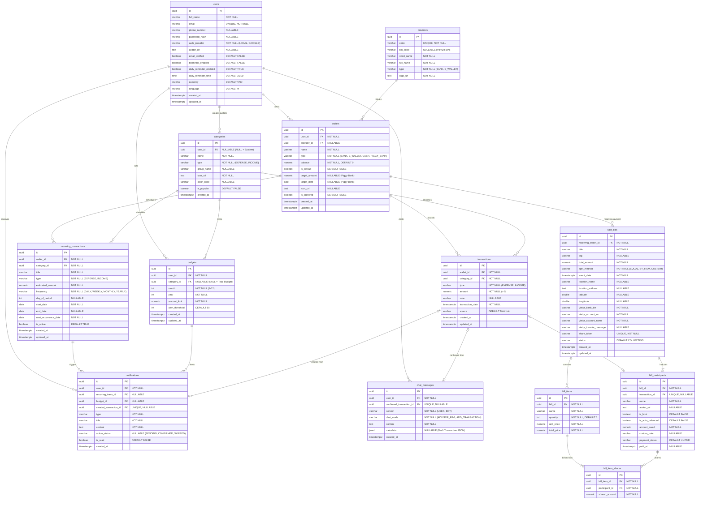

Dưới đây là tài liệu **Physical ERD (Thiết kế Cơ sở dữ liệu Vật lý chi tiết)** hoàn chỉnh cho dự án **Cozy Ledger**, được tối ưu hóa theo chuẩn **PostgreSQL (3NF/BCNF)** và đã loại bỏ 2 mối quan hệ bắc cầu dư thừa (`User -> Recurring_Trans` và `User -> Split_Bill`).

---

# TÀI LIỆU THIẾT KẾ CHI TIẾT CƠ SỞ DỮ LIỆU (PHYSICAL ERD) - COZY LEDGER

## 1. Sơ đồ ERD Chi tiết (Mermaid Diagram)



---

## 2. Đặc tả Chi tiết Các Trường Dữ Liệu (13 Bảng)

### Phân hệ 1: Người dùng & Danh mục Hệ thống (Master Data)

#### 1. Bảng `users` (Người dùng & Cài đặt cá nhân)

Lưu thông tin xác thực và các thiết lập ở màn hình Đăng ký/Đăng nhập, Chỉnh sửa hồ sơ và Cài đặt ứng dụng. (Mã OTP 6 số khi đăng ký sẽ lưu trên Redis với TTL = 120s, không lưu vào PostgreSQL).

| Tên trường | Kiểu dữ liệu | Ràng buộc | Mô tả & Ánh xạ UI |
| --- | --- | --- | --- |
| `id` | `UUID` | `PK` | Khóa chính định danh người dùng. |
| `full_name` | `VARCHAR(100)` | `NOT NULL` | Họ và tên hiển thị (VD: *"Mai Nguyễn"*, dùng làm tên Chủ TK/Chủ ví trên thẻ).|
| `email` | `VARCHAR(255)` | `UNIQUE, NOT NULL` | Địa chỉ email đăng nhập & nhận OTP.|
| `phone_number` | `VARCHAR(20)` | `NULLABLE` | Số điện thoại liên hệ (`NULL` nếu đăng ký nhanh bằng Google lần đầu).|
| `password_hash` | `VARCHAR(255)` | `NULLABLE` | Mật khẩu đã băm BCrypt (`NULL` nếu tài khoản đăng nhập hoàn toàn qua Google OAuth).|
| `auth_provider` | `VARCHAR(20)` | `NOT NULL, DEFAULT 'LOCAL'` | Phương thức xác thực: `'LOCAL'`, `'GOOGLE'`.|
| `avatar_url` | `TEXT` | `NULLABLE` | Đường dẫn ảnh đại diện của người dùng.|
| `email_verified` | `BOOLEAN` | `NOT NULL, DEFAULT FALSE` | Trạng thái xác thực OTP email (hiển thị badge *"Đã xác thực"*).|
| `biometric_enabled` | `BOOLEAN` | `NOT NULL, DEFAULT FALSE` | Bật/tắt nút gạt *"Khóa Face ID / Vân tay"*.|
| `daily_reminder_enabled` | `BOOLEAN` | `NOT NULL, DEFAULT TRUE` | Bật/tắt nút gạt *"Nhắc nhở ghi chép"* hàng ngày.|
| `daily_reminder_time` | `TIME` | `NOT NULL, DEFAULT '21:00:00'` | Giờ nhắc ghi chép mỗi tối (mặc định `21:00`).|
| `currency` | `VARCHAR(10)` | `NOT NULL, DEFAULT 'VND'` | Đơn vị tiền tệ hiển thị.|
| `language` | `VARCHAR(10)` | `NOT NULL, DEFAULT 'vi'` | Ngôn ngữ giao diện ứng dụng.|
| `created_at` | `TIMESTAMPTZ` | `NOT NULL, DEFAULT NOW()` | Thời điểm tạo TK (dùng để tính số ngày *"Đồng hành cùng Miu Miu 142 ngày"*).|
| `updated_at` | `TIMESTAMPTZ` | `NOT NULL, DEFAULT NOW()` | Thời điểm cập nhật hồ sơ gần nhất. |

---

#### 2. Bảng `providers` (Đơn vị phát hành Ngân hàng & Ví điện tử)

Lưu danh sách Ngân hàng và Ví điện tử cố định để người dùng chọn trong dropdown khi thêm ví mới và lấy mã BIN tạo VietQR.

| Tên trường | Kiểu dữ liệu | Ràng buộc | Mô tả & Ánh xạ UI |
| --- | --- | --- | --- |
| `id` | `UUID` | `PK` | Khóa chính đơn vị phát hành. |
| `code` | `VARCHAR(50)` | `UNIQUE, NOT NULL` | Mã định danh viết tắt (VD: `'SACOMBANK'`, `'VCB'`, `'MOMO'`).|
| `bin_code` | `VARCHAR(20)` | `NULLABLE` | Mã BIN ngân hàng theo chuẩn Napas (VD: `'970436'` của VCB) để render chuỗi VietQR.|
| `short_name` | `VARCHAR(100)` | `NOT NULL` | Tên ngắn hiển thị (VD: *"Sacombank"*, *"MoMo"*, *"Vietcombank"*).|
| `full_name` | `VARCHAR(255)` | `NOT NULL` | Tên đầy đủ dưới dropdown (VD: *"Ngân hàng TMCP Sài Gòn Tài Lộc"*, *"Ví điện tử MoMo"*).|
| `type` | `VARCHAR(20)` | `NOT NULL` | Phân loại đơn vị: `'BANK'`, `'E_WALLET'`.|
| `logo_url` | `TEXT` | `NOT NULL` | Logo hiển thị ở dropdown và góc trái thẻ ví.|

---

#### 3. Bảng `categories` (Danh mục Thu & Chi)

Lưu danh mục hệ thống (8 danh mục phổ biến) và danh mục do người dùng tự thêm mới.

| Tên trường | Kiểu dữ liệu | Ràng buộc | Mô tả & Ánh xạ UI |
| --- | --- | --- | --- |
| `id` | `UUID` | `PK` | Khóa chính danh mục. |
| `user_id` | `UUID` | `FK -> users(id), NULLABLE` | **`NULL`**: Danh mục mặc định của hệ thống; **`NOT NULL`**: Danh mục do user tự bấm *"+ Thêm mới"*.|
| `name` | `VARCHAR(100)` | `NOT NULL` | Tên danh mục (*"Ẩm thực"*, *"Mua sắm"*, *"Tiền lương"*, *"Thu nợ bill"*...).|
| `type` | `VARCHAR(20)` | `NOT NULL` | Loại danh mục: `'EXPENSE'` (Chi tiêu) hoặc `'INCOME'` (Thu nhập).|
| `group_name` | `VARCHAR(100)` | `NULLABLE` | Nhóm danh mục hiển thị ở màn hình Chọn danh mục (*"Chi phí sinh hoạt"*, *"Chi phí cố định"*).|
| `icon_url` | `TEXT` | `NOT NULL` | Đường dẫn/mã icon minh họa của danh mục.|
| `color_code` | `VARCHAR(20)` | `NULLABLE` | Mã màu HEX hiển thị trên biểu đồ tròn Phân bổ Dashboard (VD: `#FF7A00`, `#7B61FF`).|
| `is_popular` | `BOOLEAN` | `NOT NULL, DEFAULT FALSE` | Đánh dấu 8 danh mục phổ biến hiển thị ngay trên màn hình nhập nhanh.|
| `created_at` | `TIMESTAMPTZ` | `NOT NULL, DEFAULT NOW()` | Thời điểm tạo danh mục. |

---

### Phân hệ 2: Sổ Thu Chi Cốt lõi & Kế hoạch Tài chính (Core Ledger)

#### 4. Bảng `wallets` (Ví tiền & Hũ tích lũy Heo đất)

Gom toàn bộ 4 loại tài khoản (*Ngân hàng, Ví điện tử, Tiền mặt, Heo đất*) vào 1 bảng.

| Tên trường | Kiểu dữ liệu | Ràng buộc | Mô tả & Ánh xạ UI |
| --- | --- | --- | --- |
| `id` | `UUID` | `PK` | Khóa chính của ví. |
| `user_id` | `UUID` | `FK -> users(id), NOT NULL` | Chủ sở hữu ví. |
| `provider_id` | `UUID` | `FK -> providers(id), NULLABLE` | Đơn vị phát hành. **`NULL`** đối với ví `'CASH'` (Tiền mặt) và `'PIGGY_BANK'` (Heo đất).|
| `name` | `VARCHAR(100)` | `NOT NULL` | Tên gợi nhớ (*"Tài khoản chính"*, *"MoMo Chi tiêu vặt"*) hoặc Tên mục tiêu (*"Du lịch Đà Lạt cuối năm"*).
|
| `type` | `VARCHAR(20)` | `NOT NULL` | Loại tài khoản: `'BANK'`, `'E_WALLET'`, `'CASH'`, `'PIGGY_BANK'`.|
| `balance` | `NUMERIC(18,2)` | `NOT NULL, DEFAULT 0` | Số dư hiện tại / Số tiền bỏ sẵn ban đầu (VD: `10250000` hoặc `2000000`).|
| `is_default` | `BOOLEAN` | `NOT NULL, DEFAULT FALSE` | Nút gạt *"Đặt làm ví mặc định: Tự động ưu tiên trừ khi tạo chi tiêu mới"*.|
| `target_amount` | `NUMERIC(18,2)` | `NULLABLE` | *(Chỉ dùng cho `PIGGY_BANK`)* Mục tiêu cần đạt (VD: `10000000`). Các ví khác để `NULL`.|
| `target_date` | `DATE` | `NULLABLE` | *(Chỉ dùng cho `PIGGY_BANK`)* Dự kiến ngày hoàn thành (VD: `2026-12-31`).|
| `icon_url` | `TEXT` | `NULLABLE` | Icon đại diện cho hũ Heo đất (icon bãi biển, tiền, sách...).|
| `is_archived` | `BOOLEAN` | `NOT NULL, DEFAULT FALSE` | Cờ xóa mềm (ẩn ví khi không dùng nữa nhưng vẫn giữ lịch sử giao dịch). |
| `created_at` | `TIMESTAMPTZ` | `NOT NULL, DEFAULT NOW()` | Ngày tạo ví. |
| `updated_at` | `TIMESTAMPTZ` | `NOT NULL, DEFAULT NOW()` | Ngày cập nhật số dư gần nhất. |

---

#### 5. Bảng `transactions` (Giao dịch Thu / Chi)

Bảng trung tâm phục vụ màn hình Nhập thu chi, Lịch sử giao dịch, Thống kê Dashboard và Chi tiết ngân sách. *(Không nối trực tiếp với `users` vì đã nối qua `wallets`)*.

| Tên trường | Kiểu dữ liệu | Ràng buộc | Mô tả & Ánh xạ UI |
| --- | --- | --- | --- |
| `id` | `UUID` | `PK` | Khóa chính của giao dịch. |
| `wallet_id` | `UUID` | `FK -> wallets(id), NOT NULL` | Ví thực hiện giao dịch (VD: *Vietcombank*, *Ví MoMo*, *Tiền mặt*).|
| `category_id` | `UUID` | `FK -> categories(id), NOT NULL` | Danh mục thu/chi (hỗ trợ chạm đổi phân loại siêu nhanh trên danh sách).|
| `type` | `VARCHAR(20)` | `NOT NULL` | Loại giao dịch: `'EXPENSE'` (Chi tiêu - màu đỏ) hoặc `'INCOME'` (Thu nhập - màu xanh).|
| `amount` | `NUMERIC(18,2)` | `NOT NULL, CHECK (amount > 0)` | Số tiền giao dịch (luôn lưu số dương, VD: `65000`, `24500000`).|
| `note` | `VARCHAR(255)` | `NULLABLE` | Ghi chú / Tên khoản chi (*"Phở Bò & Cà phê sáng"*, *"Lương tháng 10 & Thưởng KPI"*).|
| `transaction_date` | `TIMESTAMPTZ` | `NOT NULL` | Ngày và giờ thực hiện giao dịch (*"05/10/2026 • 08:15"*).|
| `source` | `VARCHAR(30)` | `NOT NULL, DEFAULT 'MANUAL'` | Nguồn tạo: `'MANUAL'`, `'AI_CHAT'`, `'RECURRING'`, `'SPLIT_BILL'` (hiển thị nhãn `Chia bill • VietQR`).|
| `created_at` | `TIMESTAMPTZ` | `NOT NULL, DEFAULT NOW()` | Thời điểm bản ghi được lưu vào DB. |
| `updated_at` | `TIMESTAMPTZ` | `NOT NULL, DEFAULT NOW()` | Thời điểm chỉnh sửa giao dịch gần nhất. |

---

#### 6. Bảng `budgets` (Ngân sách theo tháng)

Phục vụ màn hình Ngân sách tổng & danh mục, Điều chỉnh ngân sách và thẻ Ngân sách ở Dashboard.

| Tên trường | Kiểu dữ liệu | Ràng buộc | Mô tả & Ánh xạ UI |
| --- | --- | --- | --- |
| `id` | `UUID` | `PK` | Khóa chính ngân sách. |
| `user_id` | `UUID` | `FK -> users(id), NOT NULL` | Người dùng thiết lập ngân sách. |
| `category_id` | `UUID` | `FK -> categories(id), NULLABLE` | **`NULL`**: Đại diện cho **Tổng ngân sách** cả tháng (VD: `3.000.000đ`); **`NOT NULL`**: Ngân sách riêng của từng danh mục (*Hóa đơn, Ăn uống, Học tập*).|
| `month` | `INT` | `NOT NULL, CHECK (1..12)` | Tháng áp dụng ngân sách (VD: `10`).|
| `year` | `INT` | `NOT NULL` | Năm áp dụng ngân sách (VD: `2026`).|
| `amount_limit` | `NUMERIC(18,2)` | `NOT NULL, CHECK (amount_limit > 0)` | Hạn mức chi tiêu tối đa trong tháng (VD: `1850000`).|
| `alert_threshold` | `INT` | `NOT NULL, DEFAULT 80` | Ngưỡng % chi tiêu để bắn thông báo cảnh báo sắp vượt ngân sách (VD: đạt 80% hạn mức). |
| `created_at` | `TIMESTAMPTZ` | `NOT NULL, DEFAULT NOW()` | Thời điểm tạo ngân sách. |
| `updated_at` | `TIMESTAMPTZ` | `NOT NULL, DEFAULT NOW()` | Thời điểm cập nhật hạn mức. |

*(Ràng buộc Unique: `UNIQUE NULLS NOT DISTINCT (user_id, category_id, month, year)` để mỗi tháng 1 user chỉ có 1 Tổng ngân sách và 1 ngân sách cho mỗi danh mục).*

---

#### 7. Bảng `recurring_transactions` (Cấu hình Giao dịch định kỳ)

Lưu mẫu giao dịch theo chu kỳ (điện, nước, wifi...). **Đã bỏ `user_id**` vì truy xuất chủ sở hữu thông qua `wallet_id`.

| Tên trường | Kiểu dữ liệu | Ràng buộc | Mô tả & Ánh xạ Nghiệp vụ |
| --- | --- | --- | --- |
| `id` | `UUID` | `PK` | Khóa chính mẫu giao dịch định kỳ. |
| `wallet_id` | `UUID` | `FK -> wallets(id), NOT NULL` | Ví sẽ được tự động trừ/cộng tiền khi người dùng bấm xác nhận. |
| `category_id` | `UUID` | `FK -> categories(id), NOT NULL` | Danh mục của khoản định kỳ (VD: *Hóa đơn*). |
| `title` | `VARCHAR(150)` | `NOT NULL` | Tên khoản thu/chi định kỳ (VD: *"Tiền điện hàng tháng"*, *"Tiền mạng Wifi"*). |
| `type` | `VARCHAR(20)` | `NOT NULL, DEFAULT 'EXPENSE'` | `'EXPENSE'` hoặc `'INCOME'`. |
| `estimated_amount` | `NUMERIC(18,2)` | `NOT NULL` | Số tiền mặc định gợi ý mỗi khi tới kỳ hạn. |
| `frequency` | `VARCHAR(20)` | `NOT NULL` | Chu kỳ lặp: `'DAILY'`, `'WEEKLY'`, `'MONTHLY'`, `'YEARLY'`. |
| `day_of_period` | `INT` | `NULLABLE` | Ngày lặp lại trong tháng (`1..31`) hoặc thứ trong tuần (`1..7`). |
| `start_date` | `DATE` | `NOT NULL` | Ngày bắt đầu áp dụng chu kỳ. |
| `end_date` | `DATE` | `NULLABLE` | Ngày kết thúc chu kỳ (`NULL` nếu lặp vô thời hạn). |
| `next_occurrence_date` | `DATE` | `NOT NULL` | Ngày đến hạn tiếp theo (Cronjob dựa vào cột này để tạo `Notification`). |
| `is_active` | `BOOLEAN` | `NOT NULL, DEFAULT TRUE` | Trạng thái đang bật hay tạm dừng. |
| `created_at` | `TIMESTAMPTZ` | `NOT NULL, DEFAULT NOW()` | Ngày tạo mẫu định kỳ. |
| `updated_at` | `TIMESTAMPTZ` | `NOT NULL, DEFAULT NOW()` | Ngày cập nhật gần nhất. |

---

### Phân hệ 3: Thông báo & Trợ lý AI (Miu Miu)

#### 8. Bảng `notifications` (Thông báo & Xác nhận giao dịch định kỳ)

Quản lý danh sách thông báo ở icon quả chuông, bao gồm thông báo xác nhận giao dịch định kỳ và cảnh báo vượt ngân sách.

| Tên trường | Kiểu dữ liệu | Ràng buộc | Mô tả & Lý do FK Nullable |
| --- | --- | --- | --- |
| `id` | `UUID` | `PK` | Khóa chính thông báo. |
| `user_id` | `UUID` | `FK -> users(id), NOT NULL` | Người nhận thông báo. |
| `recurring_trans_id` | `UUID` | `FK -> recurring_transactions(id), NULLABLE` | **Nullable**: Chỉ có giá trị khi thông báo này được sinh ra từ lịch nhắc Giao dịch định kỳ. |
| `budget_id` | `UUID` | `FK -> budgets(id), NULLABLE` | **Nullable**: Chỉ có giá trị khi thông báo này là cảnh báo sắp vượt/đã vượt Ngân sách. |
| `created_transaction_id` | `UUID` | `FK -> transactions(id), UNIQUE, NULLABLE` | **Nullable**: Ban đầu là `NULL` (hiện nút *"Xác nhận"*). Khi user bấm xác nhận tạo giao dịch định kỳ, lưu ID của `Transaction` vừa sinh ra vào đây để khóa nút xác nhận. |
| `type` | `VARCHAR(30)` | `NOT NULL` | Loại thông báo: `'RECURRING_DUE'`, `'BUDGET_ALERT'`, `'DAILY_REMINDER'`, `'SYSTEM'`. |
| `title` | `VARCHAR(200)` | `NOT NULL` | Tiêu đề thông báo (VD: *"Đến hạn thanh toán Tiền Wifi tháng 10"*). |
| `content` | `TEXT` | `NOT NULL` | Nội dung chi tiết thông báo. |
| `action_status` | `VARCHAR(20)` | `NULLABLE` | Trạng thái hành động (với `RECURRING_DUE`): `'PENDING'`, `'CONFIRMED'`, `'SKIPPED'`. |
| `is_read` | `BOOLEAN` | `NOT NULL, DEFAULT FALSE` | Đánh dấu đã đọc hay chưa. |
| `created_at` | `TIMESTAMPTZ` | `NOT NULL, DEFAULT NOW()` | Thời gian gửi thông báo. |

---

#### 9. Bảng `chat_messages` (Lịch sử Chat RAG & Bóc tách Giao dịch tự nhiên)

Lưu toàn bộ tin nhắn ở cả 2 tab **Trò chuyện (RAG)** và **Thêm giao dịch** của trợ lý Miu Miu.

| Tên trường | Kiểu dữ liệu | Ràng buộc | Mô tả & Ánh xạ UI |
| --- | --- | --- | --- |
| `id` | `UUID` | `PK` | Khóa chính tin nhắn. |
| `user_id` | `UUID` | `FK -> users(id), NOT NULL` | Người dùng đang trò chuyện với Miu Miu. |
| `confirmed_transaction_id` | `UUID` | `FK -> transactions(id), UNIQUE, NULLABLE` | **Nullable**: Bằng `NULL` nếu là chat thường hoặc khi thẻ nháp giao dịch chưa được bấm xác nhận. Khi bấm *"Xác nhận lưu vào sổ"*, gắn ID giao dịch thật vào đây để hiện hộp xanh *"Đã lưu thành công"*.|
| `sender` | `VARCHAR(10)` | `NOT NULL` | Người gửi: `'USER'` hoặc `'BOT'` (Miu Miu).|
| `chat_mode` | `VARCHAR(20)` | `NOT NULL` | Chế độ tab trên UI: `'ADVISOR_RAG'` (Trò chuyện) hoặc `'ADD_TRANSACTION'` (Thêm giao dịch).|
| `content` | `TEXT` | `NOT NULL` | **Lưu văn bản hiển thị của mọi tin nhắn**: Câu hỏi của user, câu trả lời phân tích RAG của Miu Miu, hoặc câu dẫn *"Miu Miu đã bóc tách xong giao dịch..."*.|
| `metadata` | `JSONB` | `NULLABLE` | **Nullable**: Lưu cấu trúc JSON của Thẻ nháp giao dịch khi bóc tách NLP (`{"title": "Bún bò Huế", "amount": 55000, "type": "EXPENSE", "category_id": "...", "wallet_id": "...", "tx_time": "..."}`) hoặc lời khuyên đóng khung ở chế độ RAG.|
| `created_at` | `TIMESTAMPTZ` | `NOT NULL, DEFAULT NOW()` | Thời gian gửi tin nhắn (`12:38`).|

---

### Phân hệ 4: Chia Bill Nhóm & VietQR Động (Bill Splitting)

#### 10. Bảng `split_bills` (Hóa đơn Chia tiền nhóm)

Lưu thông tin hóa đơn qua 4 bước tạo bill. **Đã bỏ `creator_id` (`user_id`)** vì liên kết trực tiếp qua `receiving_wallet_id`.

| Tên trường | Kiểu dữ liệu | Ràng buộc | Mô tả & Ánh xạ UI |
| --- | --- | --- | --- |
| `id` | `UUID` | `PK` | Khóa chính của hóa đơn chia tiền. |
| `receiving_wallet_id` | `UUID` | `FK -> wallets(id), NOT NULL` | Ví nhận tiền của Chủ xị (khi thành viên trả tiền, giao dịch thu nhập sẽ cộng vào ví này). |
| `title` | `VARCHAR(200)` | `NOT NULL` | Tên buổi gặp mặt / ăn uống (*"Lẩu Haidilao cuối tuần"*).|
| `tag` | `VARCHAR(50)` | `NULLABLE` | Nhãn gợi ý nhanh (*"Ăn uống"*, *"Cà phê"*, *"Du lịch"*, *"Mua sắm"*).|
| `total_amount` | `NUMERIC(18,2)` | `NOT NULL, CHECK (total_amount > 0)` | Tổng tiền trên hóa đơn (VD: `1850000`).|
| `split_method` | `VARCHAR(20)` | `NOT NULL` | 3 chế độ chia: `'EQUAL'` (Chia đều), `'BY_ITEM'` (Theo món), `'CUSTOM'` (Tùy chỉnh).|
| `event_date` | `TIMESTAMPTZ` | `NOT NULL` | Thời gian tụ tập ăn uống (*"05/10/2026 lúc 19:30"*).|
| `location_name` | `VARCHAR(200)` | `NULLABLE` | Tên địa điểm (*"Haidilao Landmark 81"*, *"Haidilao Hotpot Đồng Khởi"*).|
| `location_address` | `TEXT` | `NULLABLE` | Địa chỉ chi tiết trên bản đồ (*"Tầng L3, Vincom Center, 72 Lê Thánh Tôn..."*).|
| `latitude` | `DOUBLE PRECISION` | `NULLABLE` | Vĩ độ trên bản đồ.|
| `longitude` | `DOUBLE PRECISION` | `NULLABLE` | Kinh độ trên bản đồ.|
| `vietqr_bank_bin` | `VARCHAR(20)` | `NOT NULL` | Mã BIN/Tên ngân hàng tạo mã VietQR động (VD: *Vietcombank*).|
| `vietqr_account_no` | `VARCHAR(50)` | `NOT NULL` | Số tài khoản nhận tiền hiển thị dưới mã QR (*"1029384756"*).|
| `vietqr_account_name` | `VARCHAR(100)` | `NOT NULL` | Tên chủ tài khoản nhận tiền (*"NGUYEN THI MAI"*).|
| `vietqr_transfer_message` | `VARCHAR(100)` | `NULLABLE` | Cú pháp chuyển khoản (*"HD HAI DI LAO"*).|
| `share_token` | `VARCHAR(100)` | `UNIQUE, NOT NULL` | Chuỗi mã hóa duy nhất để tạo đường link web chia sẻ cho bạn bè.|
| `status` | `VARCHAR(20)` | `NOT NULL, DEFAULT 'COLLECTING'` | Trạng thái bill: `'COLLECTING'` (Đang thu tiền), `'COMPLETED'` (Đã hoàn tất 100%).|
| `created_at` | `TIMESTAMPTZ` | `NOT NULL, DEFAULT NOW()` | Thời điểm tạo bill. |
| `updated_at` | `TIMESTAMPTZ` | `NOT NULL, DEFAULT NOW()` | Thời điểm cập nhật tiến độ thu tiền gần nhất. |

---

#### 11. Bảng `bill_participants` (Thành viên tham gia chia bill)

Lưu danh sách bạn bè trong bill và tiến độ thanh toán của từng người.

| Tên trường | Kiểu dữ liệu | Ràng buộc | Mô tả & Ánh xạ UI |
| --- | --- | --- | --- |
| `id` | `UUID` | `PK` | Khóa chính thành viên trong bill. |
| `bill_id` | `UUID` | `FK -> split_bills(id), NOT NULL` | Thuộc hóa đơn chia tiền nào. |
| `transaction_id` | `UUID` | `FK -> transactions(id), UNIQUE, NULLABLE` | **Nullable**: Bằng `NULL` khi thành viên chưa trả tiền. Khi Chủ xị xác nhận thành viên này đã trả, hệ thống tự tạo 1 `Transaction` thu nhập (`+370.000đ`) và lưu ID vào đây.|
| `name` | `VARCHAR(100)` | `NOT NULL` | Tên thành viên (*"Mai"*, *"Tiến"*, *"Chính"*, *"Nam"*, *"Hưng"*, *"Thu Cúc"*).|
| `avatar_url` | `TEXT` | `NULLABLE` | Ảnh đại diện mặc định hoặc tự chọn của thành viên.|
| `is_host` | `BOOLEAN` | `NOT NULL, DEFAULT FALSE` | Đánh dấu người có nhãn **`Chủ xị` / `Host**` (người đã ứng tiền trả trước hóa đơn).|
| `is_auto_balanced` | `BOOLEAN` | `NOT NULL, DEFAULT FALSE` | Đánh dấu người nhận phần bù trừ làm tròn số lẻ (*"Nhận bù trừ tự động"*).|
| `amount_owed` | `NUMERIC(18,2)` | `NOT NULL, CHECK (amount_owed >= 0)` | Số tiền người này phải đóng (VD: Chủ xị `372000`, các bạn khác `370000`).|
| `custom_note` | `VARCHAR(255)` | `NULLABLE` | Ghi chú riêng ở chế độ Tùy chỉnh (VD: *"Ăn nhiều + gọi thêm nước"*).|
| `payment_status` | `VARCHAR(20)` | `NOT NULL, DEFAULT 'UNPAID'` | Trạng thái trên màn hình theo dõi: `'PAID_BY_HOST'` (*Đã chi trả*), `'UNPAID'` (*Chưa thanh toán*), `'PAID_TRANSFER'` (*Đã chuyển khoản*), `'PAID_CASH'` (*Tiền mặt*).|
| `paid_at` | `TIMESTAMPTZ` | `NULLABLE` | Thời điểm hoàn tất thanh toán (*"Hôm nay 20:15"*).|

---

#### 12. Bảng `bill_items` (Danh sách món ăn trong Bill)

Phục vụ chế độ chia tiền **"Theo món"** và Bottom sheet thêm món.

| Tên trường | Kiểu dữ liệu | Ràng buộc | Mô tả & Ánh xạ UI |
| --- | --- | --- | --- |
| `id` | `UUID` | `PK` | Khóa chính món ăn. |
| `bill_id` | `UUID` | `FK -> split_bills(id), NOT NULL` | Thuộc hóa đơn chia tiền nào. |
| `name` | `VARCHAR(150)` | `NOT NULL` | Tên món (*"Bia Heniken"*, *"Nước ngọt & Trà sữa refill"*, *"Lẩu bò Triều Châu"*).|
| `quantity` | `INT` | `NOT NULL, DEFAULT 1` | Số lượng món (VD: `2 đĩa`, `4 lon`).|
| `unit_price` | `NUMERIC(18,2)` | `NOT NULL` | Đơn giá của 1 đơn vị món (VD: `100000`).|
| `total_price` | `NUMERIC(18,2)` | `NOT NULL` | Tổng tiền của món đó (`quantity * unit_price`, VD: `890000`, `130000`).|

---

#### 13. Bảng `bill_item_shares` (Chi tiết người ăn từng món)

Bảng trung gian giải quyết quan hệ `N - N` khi chọn *"Ai cùng chia khoản này?"* trong từng món ăn.

| Tên trường | Kiểu dữ liệu | Ràng buộc | Mô tả & Ánh xạ UI |
| --- | --- | --- | --- |
| `id` | `UUID` | `PK` | Khóa chính bản ghi chia món. |
| `bill_item_id` | `UUID` | `FK -> bill_items(id), NOT NULL` | Món ăn được chia. |
| `participant_id` | `UUID` | `FK -> bill_participants(id), NOT NULL` | Thành viên tham gia ăn món đó (*Tiến, Mai, Hưng...*).|
| `shared_amount` | `NUMERIC(18,2)` | `NOT NULL` | Số tiền thành viên này phải chịu cho món đó (VD: *Bia tươi Tiger 130.000đ chia 2 người = `65000` / người*).|

*(Ràng buộc Unique: `UNIQUE (bill_item_id, participant_id)` để 1 người không bị tick trùng 2 lần trong cùng 1 món).*

---

## 3. Mã DBML (Dùng để import trực tiếp vào dbdiagram.io)

Nếu bạn muốn xuất ra hình ảnh sơ đồ ERD độ phân giải cao để chèn vào báo cáo hoặc tài liệu kỹ thuật, bạn chỉ cần copy đoạn code DBML dưới đây và dán vào trang **[dbdiagram.io](https://dbdiagram.io)**:

```dbml
Table users {
  id uuid [pk]
  full_name varchar(100) [not null]
  email varchar(255) [unique, not null]
  phone_number varchar(20)
  password_hash varchar(255)
  auth_provider varchar(20) [not null, default: 'LOCAL']
  avatar_url text
  email_verified boolean [not null, default: false]
  biometric_enabled boolean [not null, default: false]
  daily_reminder_enabled boolean [not null, default: true]
  daily_reminder_time time [not null, default: '21:00:00']
  currency varchar(10) [not null, default: 'VND']
  language varchar(10) [not null, default: 'vi']
  created_at timestamptz [not null]
  updated_at timestamptz [not null]
}

Table providers {
  id uuid [pk]
  code varchar(50) [unique, not null]
  bin_code varchar(20)
  short_name varchar(100) [not null]
  full_name varchar(255) [not null]
  type varchar(20) [not null]
  logo_url text [not null]
}

Table wallets {
  id uuid [pk]
  user_id uuid [not null, ref: > users.id]
  provider_id uuid [ref: > providers.id]
  name varchar(100) [not null]
  type varchar(20) [not null]
  balance numeric(18,2) [not null, default: 0]
  is_default boolean [not null, default: false]
  target_amount numeric(18,2)
  target_date date
  icon_url text
  is_archived boolean [not null, default: false]
  created_at timestamptz [not null]
  updated_at timestamptz [not null]
}

Table categories {
  id uuid [pk]
  user_id uuid [ref: > users.id]
  name varchar(100) [not null]
  type varchar(20) [not null]
  group_name varchar(100)
  icon_url text [not null]
  color_code varchar(20)
  is_popular boolean [not null, default: false]
  created_at timestamptz [not null]
}

Table transactions {
  id uuid [pk]
  wallet_id uuid [not null, ref: > wallets.id]
  category_id uuid [not null, ref: > categories.id]
  type varchar(20) [not null]
  amount numeric(18,2) [not null]
  note varchar(255)
  transaction_date timestamptz [not null]
  source varchar(30) [not null, default: 'MANUAL']
  created_at timestamptz [not null]
  updated_at timestamptz [not null]
}

Table budgets {
  id uuid [pk]
  user_id uuid [not null, ref: > users.id]
  category_id uuid [ref: > categories.id]
  month int [not null]
  year int [not null]
  amount_limit numeric(18,2) [not null]
  alert_threshold int [not null, default: 80]
  created_at timestamptz [not null]
  updated_at timestamptz [not null]
}

Table recurring_transactions {
  id uuid [pk]
  wallet_id uuid [not null, ref: > wallets.id]
  category_id uuid [not null, ref: > categories.id]
  title varchar(150) [not null]
  type varchar(20) [not null, default: 'EXPENSE']
  estimated_amount numeric(18,2) [not null]
  frequency varchar(20) [not null]
  day_of_period int
  start_date date [not null]
  end_date date
  next_occurrence_date date [not null]
  is_active boolean [not null, default: true]
  created_at timestamptz [not null]
  updated_at timestamptz [not null]
}

Table notifications {
  id uuid [pk]
  user_id uuid [not null, ref: > users.id]
  recurring_trans_id uuid [ref: > recurring_transactions.id]
  budget_id uuid [ref: > budgets.id]
  created_transaction_id uuid [unique, ref: - transactions.id]
  type varchar(30) [not null]
  title varchar(200) [not null]
  content text [not null]
  action_status varchar(20)
  is_read boolean [not null, default: false]
  created_at timestamptz [not null]
}

Table chat_messages {
  id uuid [pk]
  user_id uuid [not null, ref: > users.id]
  confirmed_transaction_id uuid [unique, ref: - transactions.id]
  sender varchar(10) [not null]
  chat_mode varchar(20) [not null]
  content text [not null]
  metadata jsonb
  created_at timestamptz [not null]
}

Table split_bills {
  id uuid [pk]
  receiving_wallet_id uuid [not null, ref: > wallets.id]
  title varchar(200) [not null]
  tag varchar(50)
  total_amount numeric(18,2) [not null]
  split_method varchar(20) [not null]
  event_date timestamptz [not null]
  location_name varchar(200)
  location_address text
  latitude double
  longitude double
  vietqr_bank_bin varchar(20) [not null]
  vietqr_account_no varchar(50) [not null]
  vietqr_account_name varchar(100) [not null]
  vietqr_transfer_message varchar(100)
  share_token varchar(100) [unique, not null]
  status varchar(20) [not null, default: 'COLLECTING']
  created_at timestamptz [not null]
  updated_at timestamptz [not null]
}

Table bill_participants {
  id uuid [pk]
  bill_id uuid [not null, ref: > split_bills.id]
  transaction_id uuid [unique, ref: - transactions.id]
  name varchar(100) [not null]
  avatar_url text
  is_host boolean [not null, default: false]
  is_auto_balanced boolean [not null, default: false]
  amount_owed numeric(18,2) [not null]
  custom_note varchar(255)
  payment_status varchar(20) [not null, default: 'UNPAID']
  paid_at timestamptz
}

Table bill_items {
  id uuid [pk]
  bill_id uuid [not null, ref: > split_bills.id]
  name varchar(150) [not null]
  quantity int [not null, default: 1]
  unit_price numeric(18,2) [not null]
  total_price numeric(18,2) [not null]
}

Table bill_item_shares {
  id uuid [pk]
  bill_item_id uuid [not null, ref: > bill_items.id]
  participant_id uuid [not null, ref: > bill_participants.id]
  shared_amount numeric(18,2) [not null]
}

```

