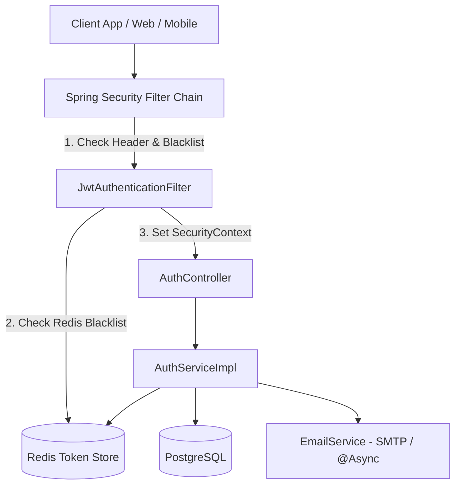

# Kiến Trúc Xác Thực (Authentication), JWT & Quản Lý Phiên (Session Management) Với Redis

> **Tài liệu tham chiếu & Tái sử dụng (Reusable Architecture Blueprint)**  
> Được đúc kết và chuẩn hóa từ hệ thống xác thực của dự án **NinePaws-Backend**, sử dụng **Spring Boot 4.1.x / Java 25**, **Spring Security**, **JJWT 0.12.x**, **PostgreSQL** và **Redis**.

---

## 1. Tổng quan Kiến trúc (Architecture Overview)

Hệ thống xác thực được xây dựng theo mô hình **Stateless REST Security** kết hợp với **Stateful Revocation Layer qua Redis**, giải quyết trọn vẹn điểm yếu cố hữu của JWT (không thể thu hồi token trước khi hết hạn) mà vẫn giữ được tốc độ cao của kiến trúc phi trạng thái.



### Các trụ cột kiến trúc cốt lõi:
1. **Mật khẩu an toàn**: Mã hóa một chiều bằng `BCryptPasswordEncoder(12)` ($2^{12} = 4096$ vòng băm).
2. **Cặp đôi Token (Dual-token pattern)**:
   - **Access Token (JWT)**: Thời hạn ngắn (15 - 30 phút), mang thông tin định danh (`userId`, `email`, `jti`, `tokenType: ACCESS`).
   - **Refresh Token (JWT)**: Thời hạn dài (7 ngày), chỉ dùng để xin cấp lại Access Token mới.
3. **Thu hồi phiên tập trung qua Redis (Token Revocation Strategy)**:
   - **Redis JTI Blacklist**: Lưu các `jti` của Access Token bị hủy (khi Logout hoặc Đổi mật khẩu) với TTL đúng bằng thời gian sống còn lại của token.
   - **Token Rotation (Xoay vòng Refresh Token)**: Mỗi lần dùng Refresh Token để lấy token mới, Refresh Token cũ sẽ bị hủy ngay lập tức và sinh ra Refresh Token mới.
   - **Quản lý đa thiết bị (User Sessions Set)**: Lưu tập hợp `jti` của tất cả các Refresh Token đang hoạt động của User vào Redis Set (`user_sessions:{userId}`). Khi cần đăng xuất khỏi tất cả thiết bị hoặc đổi mật khẩu, chỉ cần xóa sạch Set này.
4. **Mã OTP an toàn**: 6 chữ số ngẫu nhiên sinh từ `SecureRandom`, lưu trong Redis với TTL 120 giây (2 phút), áp dụng cơ chế Cooldown chống spam 60 giây và gửi email ngầm bất đồng bộ (`@Async`).

---

## 2. Chiến Lược Lưu Trữ Redis Key (Redis Key Design & TTL)

| Tên Key | Cấu trúc Key | Kiểu dữ liệu | TTL | Mục đích |
|---|---|---|---|---|
| **OTP Code** | `otp:{type}:{email}` | String | 120s (2 phút) | Lưu mã OTP 6 số (loại: `REGISTER`, `FORGOT_PASSWORD`). |
| **OTP Cooldown** | `otp_cooldown:{type}:{email}` | String | 60s (1 phút) | Khóa chặn người dùng yêu cầu gửi lại OTP liên tục. |
| **Password Reset Token** | `password_reset:{email}` | String | 600s (10 phút) | Chuỗi token bí mật tạm thời cấp sau khi xác thực OTP thành công để đổi mật khẩu. |
| **Refresh Token Data** | `refresh_token:{userId}:{jti}` | String | 7 ngày | Lưu chuỗi raw token để đối chiếu và kiểm tra tính hợp lệ. |
| **User Sessions Set** | `user_sessions:{userId}` | Set | 7 ngày | Tập hợp chứa tất cả `jti` của Refresh Token mà User đang đăng nhập trên các thiết bị. |
| **Token Blacklist** | `token_blacklist:{jti}` | String | `remainingMs` | Danh sách đen chặn các Access Token đã bị hủy nhưng chưa hết hạn tự nhiên. |

---

## 3. Luồng Nghiệp Vụ Chi Tiết (11 Endpoints)

### 3.1. Đăng ký tài khoản (`POST /register`)
- **Tái đăng ký cho tài khoản chưa kích hoạt (Unverified Account Re-entry)**:
  - Nếu email **chưa tồn tại**: Tạo bản ghi `User` mới (`email_verified = false`).
  - Nếu email **đã tồn tại và `email_verified == true`**: Báo lỗi `409 Conflict / DuplicateResourceException` (bảo vệ tài khoản đã kích hoạt).
  - Nếu email **đã tồn tại nhưng `email_verified == false`**: Tái sử dụng bản ghi cũ, cập nhật `fullName` và `passwordHash` mới nhất.
- Sinh mã OTP 6 số lưu Redis (`otp:REGISTER:{email}`).
- Gửi email HTML chứa OTP với template thương hiệu qua `@Async`.
- Phản hồi `201 Created`.

### 3.2. Xác thực OTP đăng ký (`POST /verify-registration-otp`)
- Kiểm tra mã OTP trong Redis. Nếu không khớp/hết hạn $\rightarrow$ trả `400 Bad Request` (`InvalidOtpException`).
- Cập nhật `user.email_verified = true` trong cơ sở dữ liệu.
- Kích hoạt đăng nhập tự động: Cấp cặp `accessToken` + `refreshToken`, lưu `refreshJti` vào Redis Session Set của user.
- Trả về `AuthResponse` chứa thông tin user và cặp token.

### 3.3. Gửi lại mã OTP (`POST /resend-otp`)
- Kiểm tra khóa `otp_cooldown:{type}:{email}` trong Redis. Nếu còn tồn tại $\rightarrow$ trả `429 Too Many Requests` (`RateLimitException`).
- Sinh mã OTP mới ghi đè vào Redis, đặt cooldown 60s, và gửi email mới.

### 3.4. Đăng nhập (`POST /login`)
- Tìm user theo email. Nếu không tìm thấy hoặc mật khẩu không khớp $\rightarrow$ ném `BadCredentialsException` (401).
- Kiểm tra cờ `user.email_verified`. Nếu `false` $\rightarrow$ ném `AccountNotVerifiedException` (chặn đăng nhập khi chưa kích hoạt).
- Sinh cặp token mới, lưu Refresh Token vào Redis và trả về `AuthResponse`.

### 3.5. Xoay vòng Refresh Token (`POST /refresh-token`)
- Parse JWT Refresh Token, kiểm tra chữ ký và `tokenType == 'REFRESH'`.
- Kiểm tra sự tồn tại trong Redis (`refresh_token:{userId}:{jti}`). Nếu không có $\rightarrow$ ném `TokenRevokedException`.
- **Token Rotation**: Thu hồi ngay Refresh Token cũ (`revokeRefreshToken`).
- Cấp cặp Access Token + Refresh Token mới, ghi nhận Refresh Token mới vào Redis.

### 3.6. Đăng xuất thiết bị hiện tại (`POST /logout`)
- **Blacklist Access Token**: Bóc tách chuỗi token từ header `Authorization: Bearer <token>`, trích xuất `jti` và thời gian hết hạn `expiresAt`. Ghi `token_blacklist:{jti}` vào Redis với TTL bằng số mili-giây còn lại.
- **Xóa Refresh Token**: Nhận `refreshToken` từ request body (nếu có), trích xuất `jti` và xóa khỏi Redis.

### 3.7. Đăng xuất tất cả thiết bị (`POST /logout-all`)
- Blacklist Access Token của thiết bị hiện tại vào Redis.
- Gọi `revokeAllUserSessions(userId)`: Lấy toàn bộ `jti` trong Set `user_sessions:{userId}`, xóa tất cả các key `refresh_token:{userId}:{jti}` và xóa luôn Set session.
- Mọi thiết bị khác khi hết hạn Access Token ngắn hạn sẽ không thể refresh được nữa và bị đẩy ra màn hình Login.

### 3.8. Quên mật khẩu (`POST /forgot-password`)
- Tìm user theo email.
- **Bảo mật chống dò quét tài khoản (Anti-User Enumeration)**: Nếu email không tồn tại trong hệ thống, hàm chỉ ghi log và âm thầm trả về `200 OK` như bình thường để kẻ tấn công không thể dò biết email nào đã đăng ký.
- Nếu email hợp lệ: kiểm tra cooldown $\rightarrow$ tạo OTP `FORGOT_PASSWORD` lưu Redis $\rightarrow$ gửi email hướng dẫn đặt lại mật khẩu.

### 3.9. Xác thực OTP quên mật khẩu (`POST /verify-forgot-password-otp`)
- Kiểm tra mã OTP trong Redis.
- Sinh một chuỗi ngẫu nhiên bí mật `resetToken` (UUID) lưu vào Redis (`password_reset:{email}`) với TTL 10 phút.
- Trả về `resetToken` cho client làm vé xác thực cho bước đổi mật khẩu tiếp theo.

### 3.10. Đặt lại mật khẩu (`POST /reset-password`)
- Kiểm tra `resetToken` có khớp với giá trị lưu trong Redis không.
- Băm `newPassword` mới bằng BCrypt và lưu vào DB.
- Thu hồi toàn bộ session trên tất cả các thiết bị (`revokeAllUserSessions`).

### 3.11. Chủ động đổi mật khẩu khi đang đăng nhập (`POST /change-password`)
- Nhận `userId` từ `SecurityUtils.getCurrentUserId()`.
- Kiểm tra mật khẩu cũ phải khớp với DB, mật khẩu mới không được trùng mật khẩu cũ, và xác nhận mật khẩu phải khớp.
- Băm mật khẩu mới và lưu vào DB.
- **Blacklist Access Token hiện tại**: Bóc tách `authHeader` gửi kèm request và ghi `jti` vào Redis Blacklist.
- **Hủy toàn bộ phiên đăng nhập**: Gọi `revokeAllUserSessions(userId)` để ép mọi thiết bị (kể cả máy hiện tại) phải đăng nhập lại với mật khẩu mới.

---

## 4. Chuẩn Hóa Thông Báo Lỗi Cho Request DTOs (Bean Validation)

Tất cả các Request DTO phải được định nghĩa dưới dạng Java `record` với đầy đủ thông điệp validation người dùng đọc hiểu được (tránh trả về cú pháp regex thô):

```java
public record ChangePasswordRequest(
    @NotBlank(message = "Mật khẩu hiện tại không được để trống") 
    String currentPassword,

    @NotBlank(message = "Mật khẩu mới không được để trống")
    @Pattern(
        regexp = "^(?=.*[A-Za-z])(?=.*\\d).{8,}$",
        message = "Mật khẩu mới phải có ít nhất 8 ký tự, bao gồm ít nhất một chữ cái và một chữ số")
    String newPassword,

    @NotBlank(message = "Xác nhận mật khẩu không được để trống") 
    String confirmPassword
) {}
```

---

## 5. Checklist Tái Sử Dụng Cho Dự Án Mới (Integration Checklist)

Khi áp dụng kiến trúc này vào một dự án Spring Boot mới:

- [ ] Cài đặt các starter cần thiết trong `pom.xml`:
  - `spring-boot-starter-security`
  - `spring-boot-starter-data-redis`
  - `spring-boot-starter-mail`
  - `spring-boot-starter-validation`
  - Thư viện JJWT (`jjwt-api`, `jjwt-impl`, `jjwt-jackson` bản 0.12.x trở lên).
- [ ] Bật `@EnableAsync` trong `AsyncConfig` để gửi email không chặn request.
- [ ] Cấu hình `SecurityFilterChain` ở chế độ `SessionCreationPolicy.STATELESS` và tắt CSRF.
- [ ] Đặt `JwtAuthenticationFilter` chạy trước `UsernamePasswordAuthenticationFilter`.
- [ ] Cấu hình Redis Serializer bằng `StringRedisTemplate`.
- [ ] Khai báo đầy đủ các biến môi trường vào `.env.example` và `.env` (`JWT_SECRET`, `JWT_ACCESS_EXPIRATION`, `MAIL_HOST`, `MAIL_PORT`, `EMAIL_USERNAME`, `EMAIL_PASSWORD`).
